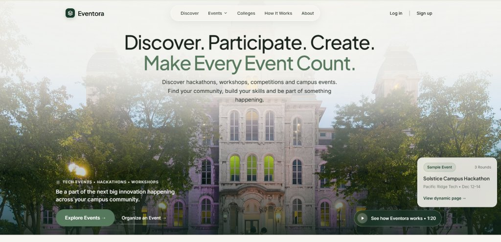

<p align="center">
  
</p>

<h1 align="center">🎯 Eventora</h1>

<p align="center">
  <strong>Discover. Participate. Create. Make Every Event Count.</strong>
</p>

<p align="center">
  A full-featured, multi-user event management platform for colleges and communities — built with vanilla HTML, CSS, JavaScript and Supabase.
</p>

<p align="center">
  <a href="#features">Features</a> •
  <a href="#screenshots">Screenshots</a> •
  <a href="#tech-stack">Tech Stack</a> •
  <a href="#getting-started">Getting Started</a> •
  <a href="#project-structure">Project Structure</a> •
  <a href="#license">License</a>
</p>

---

## ✨ Features

### For Organizers
- **Event Creation Wizard** — Create events with poster uploads, team config, registration rules, schedules and FAQs
- **Dynamic Round Builder** — Add unlimited rounds with 10+ round types (MCQ, Coding, Presentation, Workshop, Treasure Hunt, Quiz, etc.)
- **Round Content Management** — Upload PDF question papers, add MCQ questions manually, import question banks, attach challenge materials
- **Live Round Control** — Real-time event operations dashboard with countdown timers, round start/pause/resume/end, participant status tracking
- **Registration Management** — Approve/reject/waitlist registrations, custom form fields, capacity limits, deadline enforcement
- **Participants & Teams** — Full roster management, team CRUD, member assignment, leader promotion, drag-and-drop
- **Evaluation & Scoring** — Rubric-based scoring, MCQ auto-grading, criteria marks, weighted formulas, tie-breakers
- **Qualification & Progression** — Configurable qualification rules (top-N, percentage, manual), finalize and advance qualifiers to next round
- **Leaderboards** — Round-level and overall event leaderboards with publish/unpublish controls
- **Announcements** — Draft, publish and broadcast announcements per round or event-wide
- **Collaborator Management** — Invite managers and co-organizers with role-based permissions
- **Data Migration Tool** — Migrate local prototype data to PostgreSQL with one click

### For Participants
- **Event Discovery** — Browse, search and filter events by category, college, date and status
- **One-Click Registration** — Register for events with custom form fields and instant confirmation
- **Participant Dashboard** — View registered events, team assignments, round schedules, and results
- **Round Portal** — Access round content, submit answers, view scores and feedback

### Platform
- **Supabase Auth** — Google OAuth + Email/Password authentication with role-based access
- **Real-time Sync** — Live updates across tabs and devices via Supabase Realtime channels
- **Supabase Storage** — Poster/cover image uploads and PDF storage in `eventora-media` bucket
- **Row Level Security** — PostgreSQL RLS policies ensure data isolation between organizers
- **Offline-First** — Full local prototype mode works without any backend (sessionStorage + IndexedDB)
- **Responsive Design** — Works on desktop, tablet and mobile screens
- **3D Motion Effects** — Subtle parallax and depth animations on the landing page

---

## 🛠️ Tech Stack

| Layer | Technology |
|-------|-----------|
| Frontend | HTML5, CSS3 (Custom Properties), Vanilla JavaScript (ES2020+) |
| Backend | Supabase PostgreSQL, Supabase Auth, Supabase Storage, Supabase Realtime |
| Auth | Google OAuth 2.0, Email/Password, Role-based access (Organizer, Manager, Participant, Admin) |
| Dev Server | Node.js (zero-dependency static file server) |
| Database | 18 PostgreSQL migration files with RLS policies, indexes, triggers and secure views |

---

## 🚀 Getting Started

### Prerequisites

- [Node.js](https://nodejs.org/) v18 or later
- A [Supabase](https://supabase.com/) project (free tier works)

### 1. Clone the repository

```bash
git clone https://github.com/Zerythous/Event-management.git
cd Event-management
git checkout feature/eventora-platform
```

### 2. Configure Supabase (optional — works without it in prototype mode)

```bash
cp eventora/scripts/supabase-config.example.js eventora/scripts/supabase-config.local.js
```

Edit `supabase-config.local.js` with your Supabase project URL and publishable key:

```js
window.__EVENTORA_SUPABASE_CONFIG__ = {
  url: 'https://YOUR_PROJECT.supabase.co',
  publishableKey: 'YOUR_ANON_KEY',
  storageBucket: 'eventora-media'
};
```

### 3. Run the database migrations

Apply the SQL files from `supabase/migrations/` in order (001 → 006) in your Supabase SQL Editor, or use the Supabase CLI:

```bash
supabase db push
```

### 4. Start the dev server

```bash
npm run dev
```

Open [http://localhost:8000/eventora/index.html](http://localhost:8000/eventora/index.html)

---

## 📁 Project Structure

```
Event-management/
├── eventora/                    # Main Eventora platform
│   ├── index.html               # Home page — featured events & hero
│   ├── discover.html            # Event catalog with search/filter
│   ├── event.html               # Public event detail page
│   ├── register.html            # Registration flow
│   ├── login.html               # Authentication (Supabase Auth)
│   ├── signup.html              # Sign up page
│   ├── profile.html             # User profile
│   ├── organizer-dashboard.html # Organizer workspace
│   ├── manage-event.html        # Event management (rounds, content, live control)
│   ├── manager-dashboard.html   # Manager view (read-only)
│   ├── participant-dashboard.html # Participant portal
│   ├── admin-dashboard.html     # Platform admin
│   ├── superadmin-dashboard.html # Super admin controls
│   ├── scripts/
│   │   ├── events-store.js      # Central in-memory store (sessionStorage)
│   │   ├── supabase-client.js   # Supabase client initialization
│   │   ├── supabase-sync.js     # DB hydration & write-through layer
│   │   ├── realtime-sync.js     # Supabase Realtime subscriptions
│   │   ├── auth-store.js        # Authentication state management
│   │   ├── role-access.js       # Role-based access control
│   │   ├── events-api.js        # Events CRUD API
│   │   ├── rounds-api.js        # Rounds API
│   │   ├── registrations-api.js # Registration API
│   │   ├── teams-api.js         # Teams API
│   │   ├── evaluations-api.js   # Evaluation & scoring API
│   │   ├── round-builder.js     # Dynamic round configuration UI
│   │   ├── live-control.js      # Live event operations UI
│   │   ├── evaluation-manager.js # Scoring & leaderboard UI
│   │   └── ...                  # Additional modules
│   ├── styles/
│   │   ├── design-system.css    # Eventora design tokens & components
│   │   └── motion-3d.css        # 3D parallax animations
│   ├── assets/                  # Event images & hero photos
│   └── supabase/migrations/     # App-level DB migrations (001–018)
├── supabase/                    # Root-level Supabase migrations
│   ├── migrations/              # Schema, RLS, triggers (001–006)
│   └── seed.sql                 # Sample seed data
├── server.js                    # Zero-dependency Node.js static server
├── package.json
└── .gitignore
```

---

## 🔒 Security

- **Supabase credentials are never committed** — `supabase-config.local.js` and all `*.local.js` files are in `.gitignore`
- **Row Level Security (RLS)** is enforced on every table — organizers can only access their own events
- **Supabase Auth** handles all authentication — no custom password storage
- **Storage policies** restrict file uploads to authenticated users within their own event scope
- All environment files (`.env`, `.env.*`) are excluded from version control

---

## 📄 License

This project is licensed under the ISC License.

---

<p align="center">
  Built with ❤️ for campus communities
</p>
